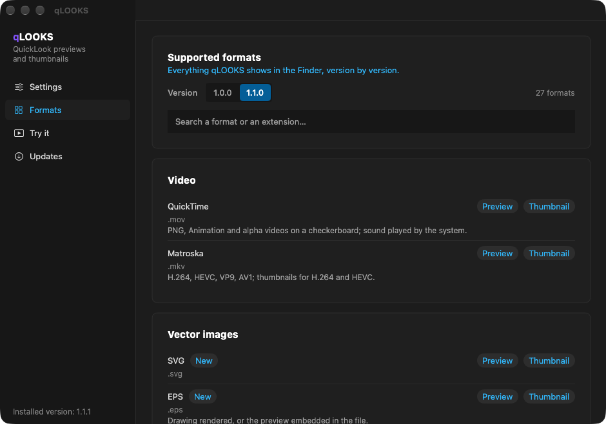

# qLOOKS

Quick Look previews and thumbnails for the formats macOS does not handle, in one app: a central app manages the supported formats (first: `.mov` with alpha — ProRes 4444, PNG, Animation — then MKV).

## About

qLOOKS is a macOS app that hosts two Quick Look extensions (preview and thumbnails). PNG and Animation codecs, which macOS no longer decodes, are read by a built-in decoder; the checkerboard, dark or light background and looped playback are available in the preview bar.
qLOOKS is made by Starbudweiser & Claude Code (Anthropic). Part of the **DESKTOP MAC TOOLKIT**. MIT License, © 2026 Starbudweiser. Provided as is, without warranty. Not affiliated with Apple or Video Copilot.
"About qLOOKS" is in the app menu.



## Requirements and installation

- macOS 15 or later, Apple Silicon.
- Download `qLOOKS-<version>.zip` from the [Releases](https://github.com/starbudweiser/qLOOKS/releases) page, unzip, and move qLOOKS to Applications. The app is signed and notarized, and updates itself from GitHub releases (daily check, can be turned off in Settings).
- Languages: French, English, Spanish, Italian.

## How it works

- A MediaExtension video decoder (`Decoder.appex`, needs a provisioning profile in `Resources/Decoder.provisionprofile`, not versioned) lets macOS play PNG and Animation `.mov` files, so Quick Look's own player works with the space bar.
- A Quick Look thumbnail extension draws the most filled frame on a checkerboard.
- A Quick Look preview extension (checkerboard player) exists, but macOS keeps its built-in movie player for `.mov`.
- Enable the decoder in System Settings > General > Login Items & Extensions > Media Extensions.

## Build

```
./build_app.sh      # builds in ~/Library/Caches/qLOOKS-build, signs, installs in ~/Applications/Applications Personnelles, registers the extensions
```

## Third-party software

qLOOKS statically links a reduced build of [FFmpeg](https://ffmpeg.org) 8.0 (LGPL v2.1+, no GPL or non-free components) to decode video formats macOS cannot read. See [ffmpeg/README.md](ffmpeg/README.md) for the exact configuration and source.
